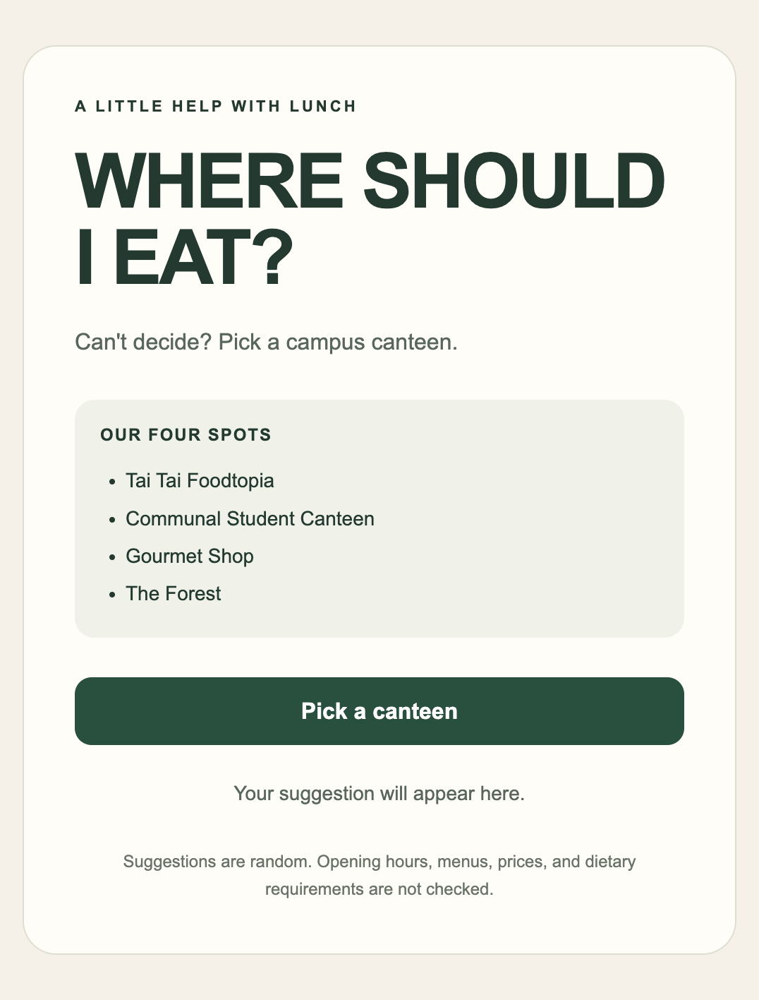

# Where Should I Eat?

A small browser-based picker that helps students choose a campus canteen.
No account, installation, or terminal is needed.

## Open the Website

Visit the live site: [Where Should I Eat?](https://shally125.github.io/week06/)

The site is deployed from this repository with GitHub Pages.

## Available Canteens

- Tai Tai Foodtopia
- Communal Student Canteen
- Gourmet Shop
- The Forest

## Run

Open `index.html` in a web browser and select **Pick a canteen**. The random
choice happens in your browser. Choose **I'll eat here** to confirm, **Pick
another** to get a different canteen, or **Start again** to return to the
beginning. Sound is optional, off by default, and uses tones generated by the
browser.

The page can also be hosted as a static site, for example with GitHub Pages.

## Sound and Motion

A brief selection animation cycles through canteen names before
revealing the result. The final suggestion still avoids repeating
the previous canteen when **Pick another** is used.

Sound is off by default. Select **Sound: Off** to enable it.
A short tone accompanies a suggestion, and a two-note sound
accompanies confirmation.

The sounds are generated in the browser, so no audio files
or additional packages are required.

The program respects the system's reduced-motion preference
and skips the selection animation when that preference is enabled.
All essential feedback is also shown as text.

Confirming a canteen triggers a brief confetti animation and a
“Great choice!” message. The confetti ends automatically and can
be cleared immediately by selecting **Start again**.

The animation is skipped when the system's reduced-motion
preference is enabled.

## Screenshot

